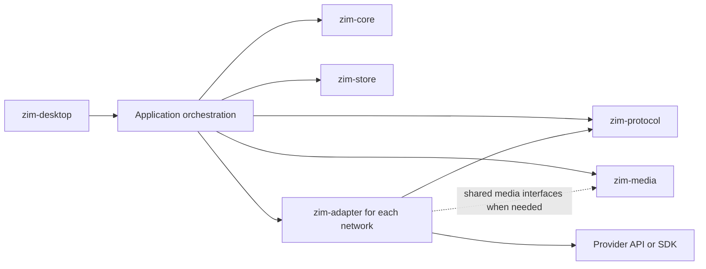

# Zim architecture

Zim connects a person-centered conversation model to independent network libraries. A Rust application can use an adapter with its own UI, contact model, credential store, and media backend. These boundaries describe the planned design. The current workspace contains the desktop shell and release tooling.

## Crate boundaries

| Layer | Responsibility |
| --- | --- |
| `zim-protocol` | A small, GUI-independent library for account sessions, provider-scoped IDs, capability queries, commands, events, and errors. It defines the interop types used by adapters and host applications. |
| `zim-adapter-<network>` | A library with a focused public constructor and provider settings. It owns authentication, protocol translation, sync cursors, provider-specific call signaling and media negotiation, and reconnect behavior. |
| `zim-core` | Local people and identity linking, conversation views, route selection, caller intent, encryption policy, and the outbox. These rules operate on the shared types. |
| `zim-store` | Application persistence for account references, contact links, cursors, messages, and the outbox. Host-owned credentials belong in the OS credential store. Provider SDK state and keys use an explicitly configured store. |
| `zim-media` | Shared media interfaces and reusable transport or device components where useful. Native capture and rendering implementations sit behind platform boundaries. |
| Application orchestration and `zim-desktop` | Compose adapters and host services, dispatch work off the UI thread, and present people, account setup, and call controls in GPUI. Application policy controls which route may be used. |

Keep `zim-protocol` independent of Zim storage, UI, and provider SDKs. Keep media interface types lightweight and make capture, rendering, and optional transport backends independently selectable. Move reusable components into shared crates once multiple adapters need the same behavior. Keep provider-specific variations inside each adapter.

## Consuming an adapter from another Rust app

- Start with one Cargo library crate per network. Offer a small typed constructor, asynchronous account sessions, and documented events, errors, and lifetimes. Keep exhaustive provider SDK types, access tokens, protocol internals, and platform handles out of the shared interface.
- Accept caller-provided session storage, credentials, and media services through small interfaces where required. Document runtime, thread affinity, filesystem access, and native dependencies. Use optional Cargo features where practical so a text-only consumer can omit media dependencies. Verify the default and applicable optional configurations in CI.
- Maintain a headless Rust example that initializes the adapter and consumes the public API without the Zim app or desktop crates. Exercise it from a standalone consumer manifest in tests. Document supported targets, auth setup, capability flags, and supported SDK versions. Keep examples runnable with fake or explicitly supplied test accounts.
- Use workspace path dependencies for development. Review public API compatibility, GPL and upstream license obligations, and dependency availability before distributing individual crates. For a registry release, use versioned dependencies that resolve outside the workspace, including the shared contract. [Cargo dependency locations](https://doc.rust-lang.org/cargo/reference/specifying-dependencies.html#multiple-locations)
- Register bundled adapters at build time. If separately installed plugins are needed later, define a versioned IPC protocol with account-scoped permissions and failure isolation. Give the IPC layer its own compatibility contract, independent of crate internals.

## Shared contract and capabilities

Preserve the network, server or tenant, local account, and provider IDs needed to identify a route, conversation, message, or call. Keep the transport's identity model separate from Zim's person links. Report those identifiers through typed commands and events and translate provider failures into actionable outcomes such as unsupported, permission required, temporary failure, or unknown outcome. Make sync, reconnect, cursor commit, and replay behavior explicit. Bound event queues and handle cancellation at the account and call level.

Discover capabilities on the account and destination in use. Model direct and group text, voice calling, video calling, and screen sharing separately. Within a call, report which track types can be sent or received, which roles can present, and what security state was negotiated. Availability can depend on the service, account type, peer, conversation, client platform, and current permissions. Treat unknown availability as a distinct state from unsupported. Refresh session capabilities when negotiation or permissions change.

Voice calls, video calls, and screen sharing are deliverables for every supported network that offers them. For each network and feature, publish the status as verified, planned, blocked by the integration, unavailable on the network, or unknown. A service's first-party client may expose capabilities that a bot, business API, or bridge cannot provide. Explain the difference in the network issue, investigate a viable route for missing features, and offer users only the actions available on the selected route. The [protocol roadmap](protocols.md) defines the checks for tracking this work.

## Calls and screen sharing

Select an eligible route when placing a call and show the chosen network, account, and target. When a call arrives, resolve the person using explicitly linked identities and display the original network and account. An invitation or active session belongs to one provider and local account. Keep the route pinned until the call ends. If the provider can recover the same session after a disconnect, use its documented recovery flow. Starting a call through another account or network requires a new user action. Use a client-generated attempt ID to correlate the request and provider response. Guard against duplicate invitations, stale events, and repeated hangups.

Represent outgoing dialing or incoming ringing, connecting, active, and ended states explicitly. Cover accept, decline, cancel, and hangup, and track audio, camera, and screen tracks independently of the call lifecycle. Make mute, camera toggle, share, and stop-share operations available when the route and session allow them. A camera or capture failure should leave an otherwise working voice call active where the provider permits it.

Keep signaling, identity, and provider-specific negotiation in the adapter. Reuse maintained media, codec, and cryptographic implementations where compatible. Support SDK-managed media behind the same call controls when the provider requires it. Let a host supply device input, screen selection, and output or rendering services through the media interface. Keep bulk audio, video, and screen frames on bounded media paths, separate from control events and chat synchronization.

Ask for microphone, camera, or screen access when the user enables the corresponding track. Use the platform's source picker where available and show which source is shared with a visible stop control. Allow screen audio only after explicit selection and when the route supports it. Release capture and transport resources on hangup, logout, permission revocation, or terminal failure. Keep media and call secrets out of routine logs and persistence. Enforce encryption policy using the negotiated media security state, independently of text and call-signaling encryption. [macOS ScreenCaptureKit](https://developer.apple.com/documentation/screencapturekit) · [Linux ScreenCast portal](https://flatpak.github.io/xdg-desktop-portal/docs/doc-org.freedesktop.portal.ScreenCast.html)

## Verification and rollout

Use two simulated networks to test the shared contract in CI with deterministic events and media fixtures. Cover identity and account isolation, capability changes, reconnect and replay, and cancellation. For call behavior, test simultaneous invitations, denied device permission, a failed screen share during an active voice call, disconnect handling, and cleanup. Exercise both the initial call route and attempts to start a new call after changing routes.

For each real adapter and capability, use authorized test accounts or controlled deployments to verify interoperability with an existing client where possible. Check caller and recipient behavior, negotiated encryption, and platform permissions on the supported OSes. Run the reusable crate's tests and headless example independent of the desktop test. Update its capability status when provider behavior or support changes.

The first messaging milestone validates text, presence, and person routing across XMPP and Matrix. Validate the calling contract with fixtures and incrementally implement voice, video, and screen sharing on supported network routes. Keep per-feature gaps visible while those adapters mature. [Project plan](plan.md)
